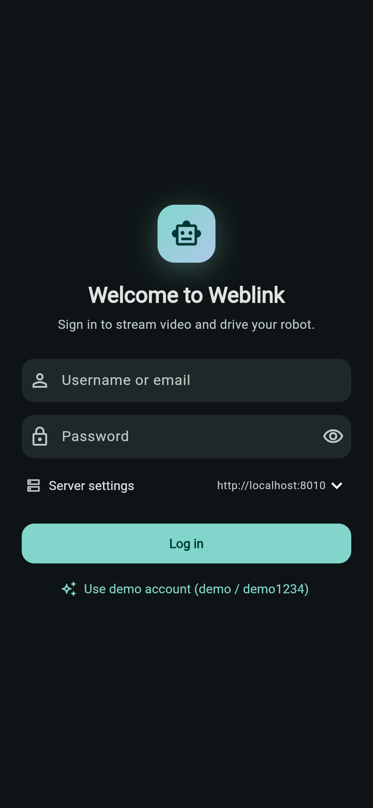
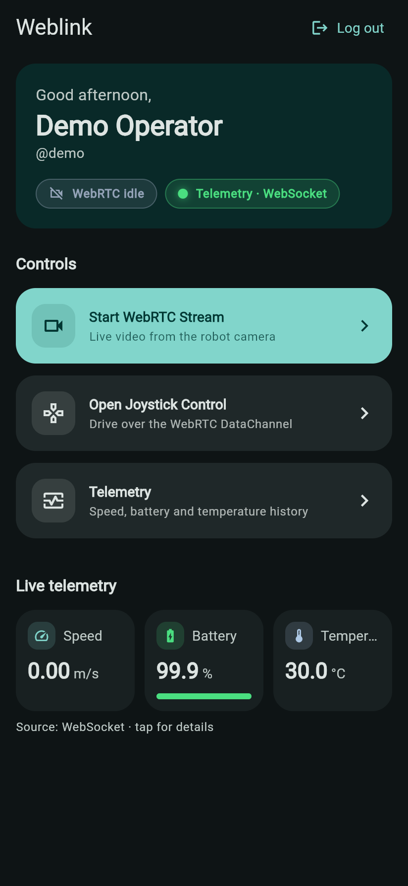
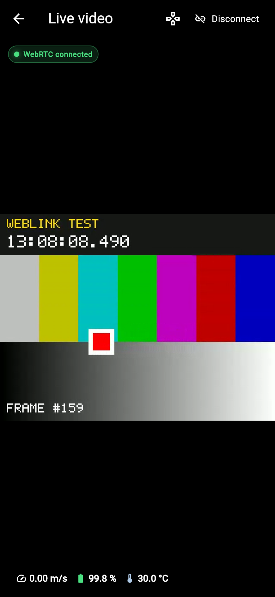
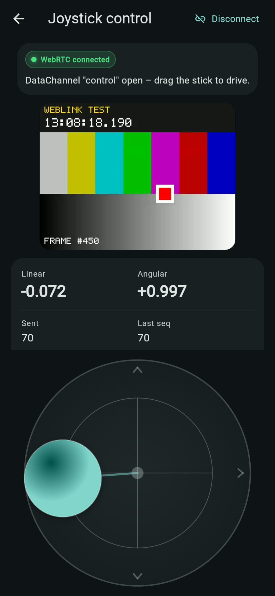
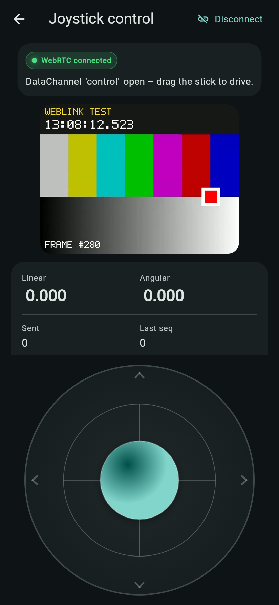
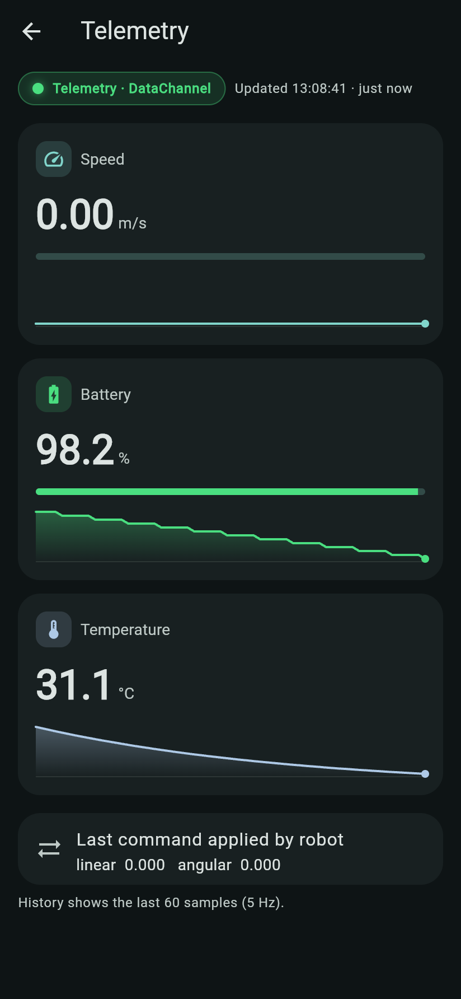
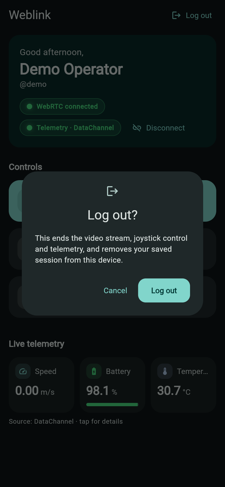
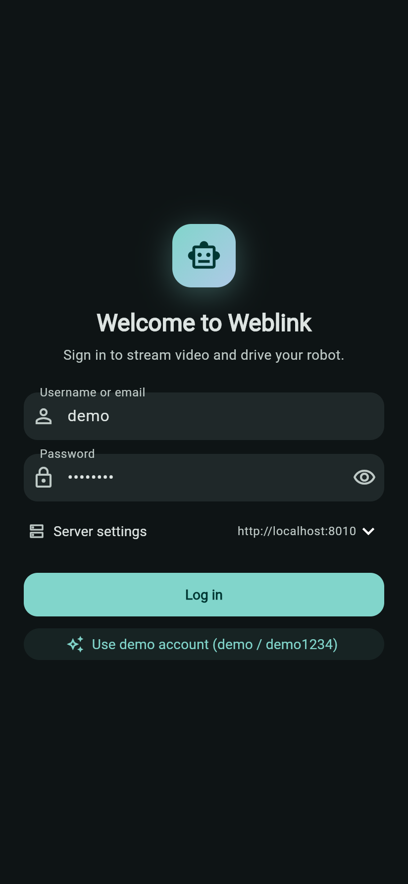

# Weblink — Flutter WebRTC robot console

A Flutter mobile app that logs in with JWT, watches a live WebRTC video stream, drives a robot with an on-screen joystick over a **WebRTC DataChannel**, and shows live telemetry (speed, battery, temperature). The backend is **Python FastAPI + aiortc**: auth API, WebSocket signaling, a video publisher (test pattern, webcam or video file) and a simulated robot.

```
Flutter app (repo root)                      Backend (backend/)
┌─────────────────────────────┐   REST      ┌──────────────────────────────┐
│ Login ─► Home ─┬► Video     │ ──────────► │ /api/auth/login, /me  (JWT)  │
│                ├► Joystick  │   WS        │ /ws/signaling  offer/answer  │
│                └► Telemetry │ ──────────► │ /ws/telemetry  5 Hz fallback │
│ RobotSession: 1 PeerConn    │  WebRTC     │ aiortc PeerConnection        │
│  + "control" DataChannel    │ ◄─video──── │  VideoSource → MediaRelay    │
│                             │ ◄─telemetry─│  RobotSimulator              │
│                             │ ─joystick──►│  (logs linear/angular)       │
└─────────────────────────────┘             └──────────────────────────────┘
```

The full wire contract (every message and field) is in [docs/ARCHITECTURE.md](docs/ARCHITECTURE.md).

## Requirements

- Flutter 3.47+ / Dart 3.13+
- Python 3.10+, ffmpeg libraries (installed with PyAV wheels on most systems)
- Optional: a webcam (`/dev/video0`) for `VIDEO_SOURCE=webcam`

## 1. Run the backend

```bash
cd backend
python3 -m venv .venv
.venv/bin/pip install -r requirements.txt
.venv/bin/uvicorn app.main:app --host 0.0.0.0 --port 8010
```

Video source options:

```bash
VIDEO_SOURCE=test   .venv/bin/uvicorn app.main:app --host 0.0.0.0 --port 8010   # default, no hardware
VIDEO_SOURCE=webcam .venv/bin/uvicorn app.main:app --host 0.0.0.0 --port 8010   # /dev/video0
VIDEO_SOURCE=file:/abs/path/clip.mp4 .venv/bin/uvicorn app.main:app --host 0.0.0.0 --port 8010
```

To keep tokens valid across restarts, set a persistent secret (≥ 32 chars):

```bash
export JWT_SECRET=$(python3 -c "import secrets; print(secrets.token_urlsafe(48))")
```

All environment variables are listed in [backend/README.md](backend/README.md).

> Port **8010** is the default because 8000/8080 are commonly taken. Use `--host 0.0.0.0` so phones and emulators on your network can reach it.

## 2. Run the Flutter app

```bash
flutter pub get
flutter run                 # a connected Android/iOS device or emulator
flutter run -d chrome       # web, for quick testing
```

On the login screen, open **Server settings** and enter the backend URL:

| Where the app runs | Server URL |
|---|---|
| Android emulator | `http://10.0.2.2:8010` (default on Android) |
| iOS simulator / web / desktop | `http://localhost:8010` (default elsewhere) |
| Physical phone on the same Wi-Fi | `http://<your-computer-LAN-IP>:8010` |

Log in with **`demo` / `demo1234`** (or `demo@weblink.local`), or tap **Use demo account**.

Release builds:

```bash
flutter build apk --release    # Android
flutter build ios --release    # iOS (needs Xcode signing)
flutter build web --release
```

Cleartext `http://`/`ws://` is allowed only in Android debug/profile builds and on iOS local networks. A release build pointed at a remote server needs HTTPS/WSS (put the backend behind a TLS reverse proxy).

## 3. Login & JWT

1. `POST /api/auth/login` `{"username": "...", "password": "..."}` checks the bcrypt hash and returns `{"access_token", "token_type": "bearer", "expires_in", "user"}`.
2. The token is an **HS256 JWT** with claims `sub`, `iat`, `exp` (60 min by default), `iss=weblink`. The server pins the algorithm and requires every claim.
3. The app stores the token in **flutter_secure_storage** (Android Keystore / iOS Keychain). At startup it validates the token with `GET /api/auth/me`, then skips straight to Home.
4. REST calls send `Authorization: Bearer <jwt>`. WebSockets pass `?token=<jwt>` (browsers can't set headers on WebSockets); tokens are redacted from the server's logs.
5. **Logout**, any `401`, a WebSocket close code **4401**, or the token's `exp` passing all do the same thing: delete the token, tear down the peer connection and sockets, and return to Login with the navigation stack cleared.

Hardening: unknown usernames take as long to reject as wrong passwords (no user enumeration); 5 failed logins per IP per minute → `429`; a user can hold at most 3 signaling sockets (`4429`); sockets are closed when their token expires; the server refuses to start with a `JWT_SECRET` shorter than 32 characters.

## 4. WebRTC signaling flow

```
App                                   Backend
 │  WS /ws/signaling?token=JWT  ───►  │  validate JWT (else close 4401)
 │  create RTCPeerConnection          │
 │   + recvonly video transceiver     │
 │   + DataChannel "control"          │
 │  {"type":"offer","sdp":...}  ───►  │  setRemoteDescription, attach video track
 │  {"type":"ice",...} (trickle) ──►  │  addIceCandidate (buffered until the offer)
 │  ◄───  {"type":"answer","sdp":...} │  answer carries the server's ICE candidates
 │  ═══════ ICE / DTLS / SRTP ═══════ │
 │  ◄──────── video track ─────────── │  test pattern / webcam / file via MediaRelay
 │  ── joystick JSON @ 20 Hz ───────► │  log + feed the robot simulator
 │  ◄─────── telemetry JSON @ 5 Hz ── │
 │  {"type":"bye"} or close     ───►  │  close the peer connection, free resources
```

DataChannel messages:

```json
{"type": "joystick", "linear": 0.42, "angular": -0.10, "seq": 17, "ts": 1730551234567}
{"type": "telemetry", "speed": 0.63, "battery": 87.4, "temperature": 36.2, "linear": 0.42, "angular": -0.10, "ts": 1730551234600}
```

- The joystick sends at 20 Hz while held, plus one zero on release. Up = +linear, left = +angular, with a 0.08 dead-zone and values clamped to the unit circle.
- If no command arrives for 500 ms, the robot stops (dead-man switch).
- Telemetry comes over the DataChannel while WebRTC is connected. Otherwise the app falls back to `/ws/telemetry`, which is what the Home screen uses before you start a stream.

## 5. Example commands

```bash
# health + login
curl -s localhost:8010/api/health
TOKEN=$(curl -s -X POST localhost:8010/api/auth/login -H 'Content-Type: application/json' \
  -d '{"username":"demo","password":"demo1234"}' | python3 -c 'import sys,json;print(json.load(sys.stdin)["access_token"])')
curl -s localhost:8010/api/auth/me -H "Authorization: Bearer $TOKEN"

# telemetry stream without WebRTC (needs websocat)
websocat "ws://localhost:8010/ws/telemetry?token=$TOKEN"

# headless WebRTC client: sine-wave joystick for 10 s, prints telemetry + video frame count
cd backend && WEBLINK_PASSWORD=demo1234 .venv/bin/python scripts/test_client.py --url http://localhost:8010 --duration 10
```

Server log while driving:

```
INFO    weblink.control: joystick seq=12 linear=+0.921 angular=+0.391
```

## 6. Tests

```bash
cd backend && .venv/bin/pytest -q      # unit + end-to-end tests against a real server
flutter analyze && flutter test        # Flutter static analysis + unit/widget tests
```

The backend end-to-end tests run a real uvicorn server with an aiortc client. They cover login, offer/answer, trickle ICE, the DataChannel round trip, video frames, the 4401/4429 close codes, token expiry and resource cleanup.

## 7. Screenshots

| Login | Home | Live video | Joystick (driving) |
|---|---|---|---|
|  |  |  |  |

| Joystick (idle) | Telemetry | Logout | Demo login |
|---|---|---|---|
|  |  |  |  |

- **Home** shows telemetry over the WebSocket before any stream is started.
- **Live video** is the backend's test pattern; the frame counter and clock prove it is live.
- **Joystick** shows the values being sent (`linear -0.072, angular +0.997`) and the message count / sequence number. Matching server log:

  ```
  INFO    weblink.control: joystick seq=40 linear=+1.000 angular=+0.000
  ```
- **Telemetry** switches to the DataChannel once WebRTC is connected and charts the last 60 samples.

## 8. Demo video

[docs/demo/weblink-demo.mp4](docs/demo/weblink-demo.mp4) is a one-minute recording of the real app (web build) against the real backend: login → home telemetry → WebRTC stream → joystick driving → live telemetry screen → logout.

The video and the screenshots above are recorded automatically, so you can regenerate them after UI changes:

```bash
flutter build web --no-web-resources-cdn
(cd backend && .venv/bin/uvicorn app.main:app --port 8010) &
(cd build/web && python3 -m http.server 5190) &
cd tools/demo && npm install
SHOTS_DIR=../../docs/screenshots node record_demo.js demo.webm   # needs Chrome + ffmpeg
ffmpeg -i demo.webm -c:v libx264 -pix_fmt yuv420p -movflags +faststart ../../docs/demo/weblink-demo.mp4
```

For a phone recording, run the app on a device with `flutter run` and use the OS screen recorder.

## Project layout

```
lib/
  app.dart             composition root: services, providers, auth-gated routes, logout teardown
  services/            auth, token storage, API client, signaling, RobotSession (WebRTC), telemetry
  screens/             login, home, video, joystick, telemetry
  widgets/             joystick, sparkline, telemetry cards, status chip
backend/app/           FastAPI app, auth/JWT, signaling, telemetry, robot simulator, video sources
backend/tests/         pytest unit + end-to-end tests
docs/ARCHITECTURE.md   wire contract shared by both sides
```
